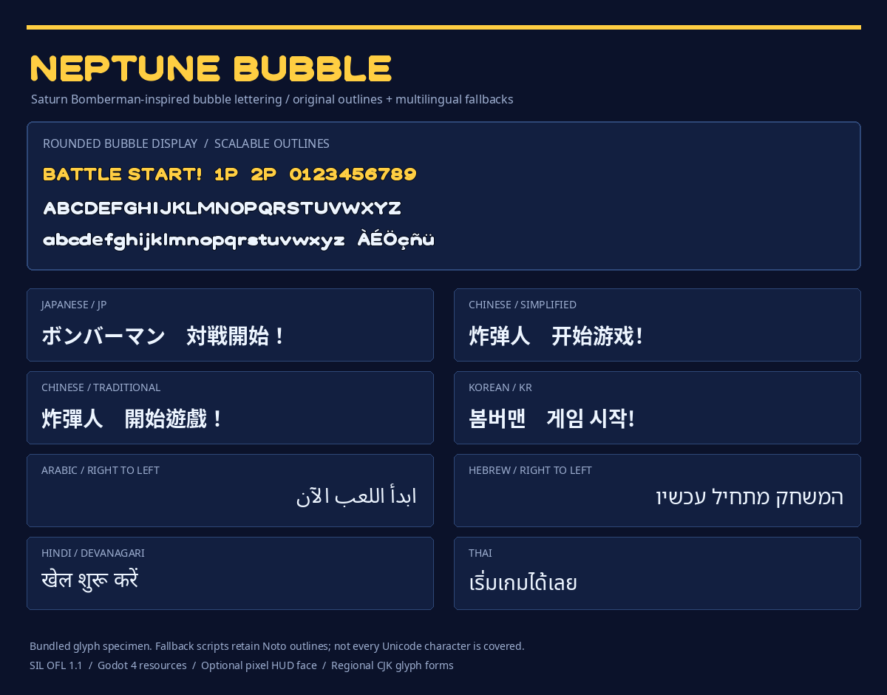

# Neptune Bubble: multilingual Godot font pack

An original rounded bubble display face inspired by Saturn Bomberman's playful
lettering, with bundled Noto fallbacks for international player names and UI.
Thick curved strokes, open counters and distinct lowercase provide the bubble
shape; gold fill, dark outline and shadow are applied by the display theme or
specimen. This is an independently drawn interpretation, not an exact recreation
or extraction of Saturn lettering. The earlier Neptune Arcade pixel face remains
available for compact HUD use. The directory/resource names stay stable for
existing Godot references.

## Use in Godot 4

Copy this entire directory to `res://fonts/neptune-arcade/`. Assign
`neptune_arcade.tres` as your Theme's `default_font`, or load the appropriate
regional resource directly:

| Resource | Preferred CJK glyph forms |
| --- | --- |
| `neptune_arcade.tres`, `neptune_arcade_ja.tres` | Japanese |
| `neptune_arcade_zh_Hans.tres` | Simplified Chinese |
| `neptune_arcade_zh_Hant.tres` | Traditional Chinese, Taiwan |
| `neptune_arcade_zh_HK.tres` | Traditional Chinese, Hong Kong |
| `neptune_arcade_ko.tres` | Korean |

Resources use relative paths so the directory can be moved. They keep system
fallback disabled: the bundled fonts determine the result on desktop and web.
Godot's advanced text server performs shaping and bidirectional layout. Preserve
Unicode text and set Control language/direction as appropriate; do not reverse
Arabic/Hebrew strings manually. These assets do not translate game text or add
an input method.

The default `dist/NeptuneBubble.ttf` uses smooth quadratic outlines. Use 16–32 px
for display text; the imported face enables grayscale antialiasing. The optional
`neptune_pixel.tres` uses `dist/NeptuneArcade.ttf` on a native 8 px grid: use 8, 16,
24 or 32 px with integer viewport scaling for crisp pixel HUD labels.

Dense CJK and complex scripts use readable Noto outlines; use at least 16–24 px
and provide enough line height. These fallback faces are not newly drawn bubble
alphabets. Small 6–10 px HUD labels suit short Latin scores. Keep player names and
localized UI in layouts that can grow and wrap. Font assets supply glyph geometry;
outline, shadow and fill colors belong to Godot themes.

Neptune's game integration selects a regional resource when the translation
locale changes. It uses this pack for the project theme and removes the old
missing CharacterSelect font override. The standalone showcase and engine smoke
checks live in the game repository under `tools/fonts/`.



This image is a glyph specimen, not a Godot screen capture.

## Coverage and limits

`coverage.json` records the actual Unicode codepoint ranges of the bundled Noto
fonts; `sources.json` pins their bytes and internal versions. `sample-texts.json`
contains language samples used by the verifier. The display faces' cmaps
and reproducible source are in `dist/` and `source/`.

Unicode is an encoding, not a guarantee that a font covers every language. This
package does not claim all Unicode, every historic script, emoji presentation,
variation sequence or language-specific typographic convention. Noto's bundled
version predates some new Unicode assignments. Full script glyph coverage also
does not establish correct spelling, translation, shaping or native-reader
quality for every language. Add a licensed fallback for a missing script, rebuild
the coverage manifest and regenerate the Godot resources; never map unsupported
characters to a generic letter to conceal a gap.

## Rebuild and verify

Install the Python dependencies listed in `tools/requirements.txt`. The original
font can be rebuilt without any reference game files:

```sh
python3 tools/build_bubble.py
python3 tools/build_bubble.py --check
python3 tools/build_arcade.py
python3 tools/build_arcade.py --check
python3 tools/bundle_fallbacks.py --check
```

The bundler documents its local Noto source arguments in `--help`. Its source
checksums identify the exact installed distribution used for this version;
font data are shipped in this directory, so normal game builds do not need
network downloads or fonts installed on the player's operating system.

The game repository's `tools/fonts/generate_resources.py` regenerates the Godot
resources from this directory, and `tools/fonts/check.py` validates shaping and
locale selection using real Godot. Keep the two repository copies byte-identical. Tall stacked Latin accents can
extend beyond the normal line box; allow extra line spacing for multiline text.

## License

The original Neptune Bubble and Neptune Arcade fonts and their font sources use SIL OFL 1.1; see `LICENSE.txt`. Bundled
Noto fonts retain their original SIL OFL 1.1 notices under `licenses/`. See each
font's embedded names/copyright and the source manifest. These font licenses are
separate from Neptune's Apache-2.0 engine license. No SEGA/Hudson font artwork is
included in this pack.
